<p align="center">
  
</p>

<h1 align="center">Minecraft Server Manager</h1>

<p align="center">
  <b>Create, mod, run and share Minecraft Java Edition servers on Windows – vanilla or modded, in a few clicks.</b><br>
  Every official version · Paper · Purpur · Folia · Fabric · Quilt · Forge · NeoForge · Modrinth modpacks · Bedrock crossplay
</p>

<p align="center">
  <a href="https://github.com/clawdroppin/Minecraft_Vanilla-Modded_ServerManager/releases/latest"></a>
  <a href="https://github.com/clawdroppin/Minecraft_Vanilla-Modded_ServerManager/releases"></a>
  
  <a href="LICENSE"></a>
</p>

<p align="center">
  <a href="https://github.com/clawdroppin/Minecraft_Vanilla-Modded_ServerManager/releases/latest"><b>⬇ Download</b></a> ·
  <a href="docs/USER_GUIDE.md"><b>📖 User guide</b></a> ·
  <a href="CHANGELOG.md"><b>📝 What's new</b></a> ·
  <a href="#-troubleshooting"><b>🛠 Troubleshooting</b></a> ·
  <a href="AGENTS.md"><b>🤖 For developers & AI agents</b></a>
</p>

<p align="center">
  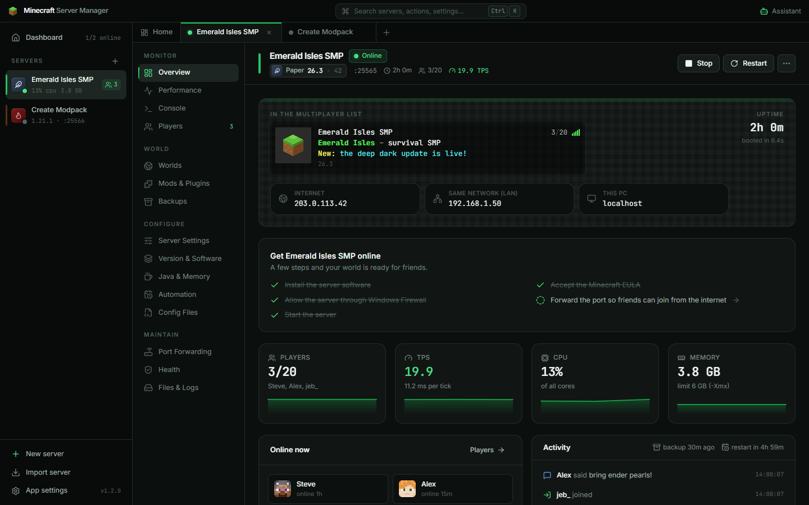
</p>

---

## ✨ Why this manager

<table>
<tr>
<td width="50%" valign="top">

### 🧱 Every version, always current
All official releases and snapshots straight from Mojang – 2012 to today – plus **Paper, Purpur, Folia, Fabric, Quilt, Forge and NeoForge** pulled live from their official sources. New Minecraft versions show up the day they ship, and the app tells you.

</td>
<td width="50%" valign="top">

### 🧩 Mods, plugins & modpacks
Search **Modrinth**, **Hangar** and **CurseForge** inside the app. Dependencies install themselves, client-only mods are skipped, updates are one click and a whole **Modrinth modpack** becomes a server in one step.

</td>
</tr>
<tr>
<td valign="top">

### 📱 Bedrock crossplay
One click sets up **Geyser + Floodgate** so friends on phones, tablets, Xbox, PlayStation, Switch and Windows can join your Java server – no Java account needed.

</td>
<td valign="top">

### 🌐 Friends can actually join
**UPnP** auto-forwarding, a router-by-router manual guide, a **Windows Firewall** fix (including the hidden Java “Block” rules), **CGNAT** detection and a real *“can the internet reach my server?”* test.

</td>
</tr>
<tr>
<td valign="top">

### ☕ Java handled for you
The exact Java each version needs (8, 17, 21, 25) is found or downloaded automatically. Memory recommendations based on your mod count, Aikar's flags, ZGC, CPU affinity.

</td>
<td valign="top">

### ⏱ Hands-off hosting
Crash recovery, scheduled restarts with in-game countdowns, smart backups, automatic build updates, Discord/Slack alerts, tray mode and start-with-Windows. Servers keep running when the app is closed.

</td>
</tr>
<tr>
<td colspan="2" valign="top">

### 🤖 A local AI assistant that can actually do things
Connect **Ollama**, **LM Studio**, llama.cpp or Jan and press **Ctrl+J**. The assistant knows how the app works and sees your servers live: it reads crash reports and logs, explains problems, edits configs, tunes settings, sets up restarts and backups, installs mods – and asks you before every change. Runs entirely on your PC.

</td>
</tr>
</table>

### And much more
- **Live console** with command, player and gamerule autocomplete · **TPS / MSPT, players, CPU, memory charts**
- **MOTD designer** with Minecraft colour codes and a server-list preview · **server icon** editor
- **Players**: whitelist, operators, bans, IP bans, chat feed and a **stats leaderboard** (play time, deaths, kills, distance, blocks mined)
- **Worlds**: seeds and versions from `level.dat`, import singleplayer saves, reset the Nether/End, datapacks, **pre-generate terrain** with Chunky
- **Essentials**: one-click performance and admin add-ons – Lithium, FerriteCore, ModernFix, spark, LuckPerms, EssentialsX, BlueMap, Simple Voice Chat…
- **Client pack** export: players import one `.mrpack` into the Modrinth App or Prism Launcher and join with matching mods
- **Health check** that finds wrong Java, client-only mods, closed ports, offline mode and crash causes – with a fix button for each
- **Nothing is ever lost**: removed worlds and mods go to a quarantine folder, restores and version switches back up first

## 📸 Screenshots

| | |
|:---:|:---:|
| 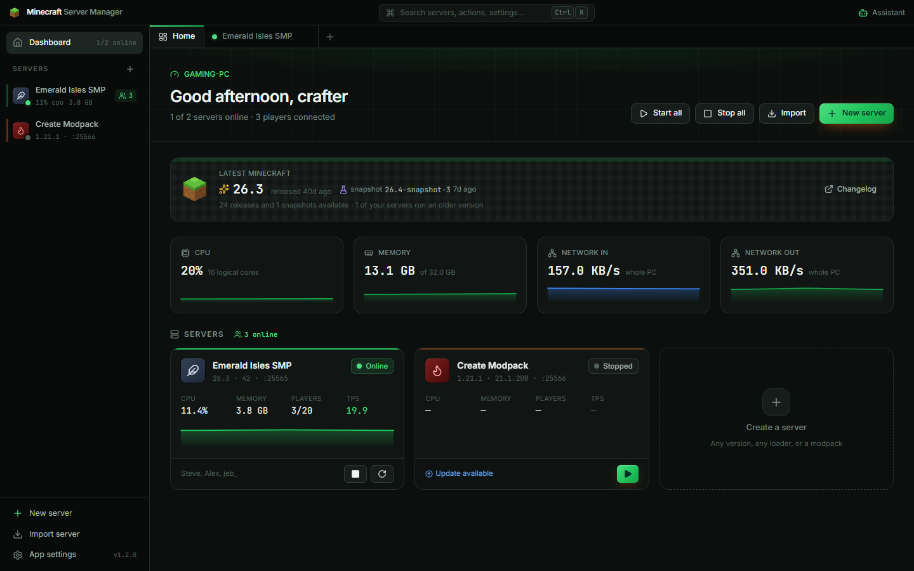 <br> **Dashboard** – every server at a glance | 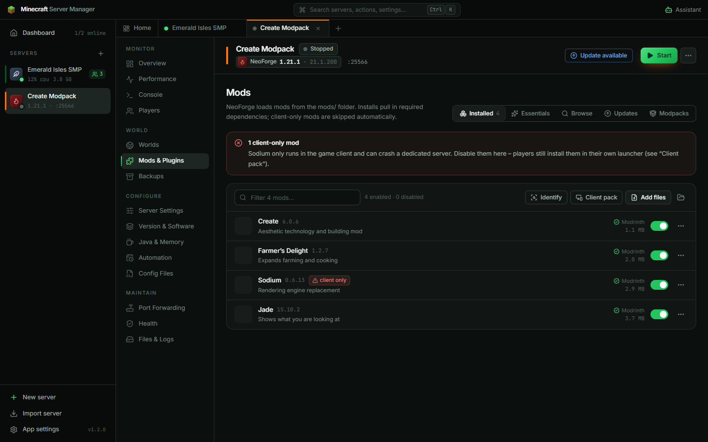 <br> **Mods & plugins** – installed, with sources and updates |
| 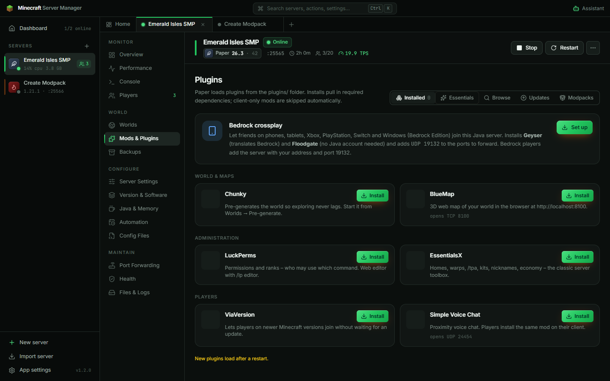 <br> **Essentials** – Bedrock crossplay and one-click add-ons | 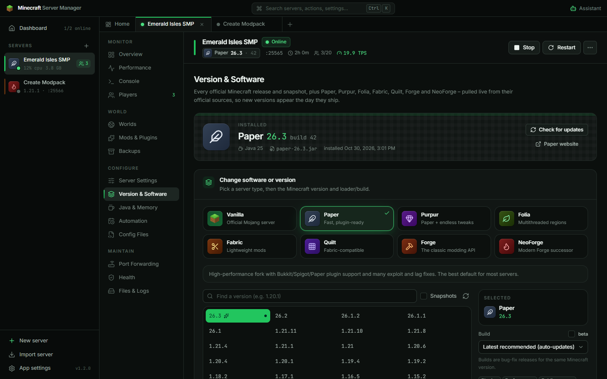 <br> **Version & software** – every release and loader |
| 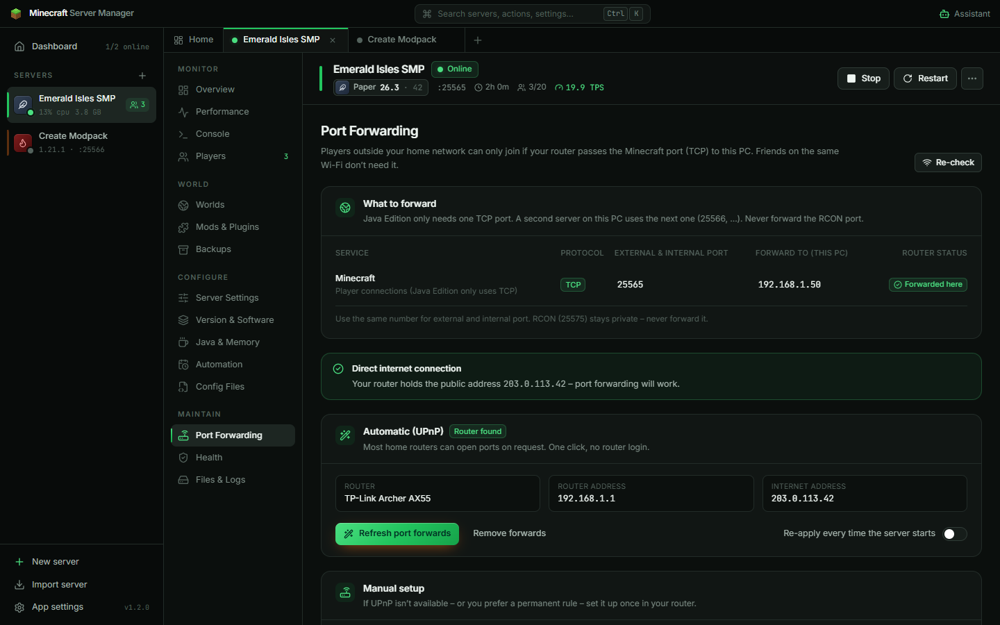 <br> **Port forwarding** – UPnP, firewall, reachability test | 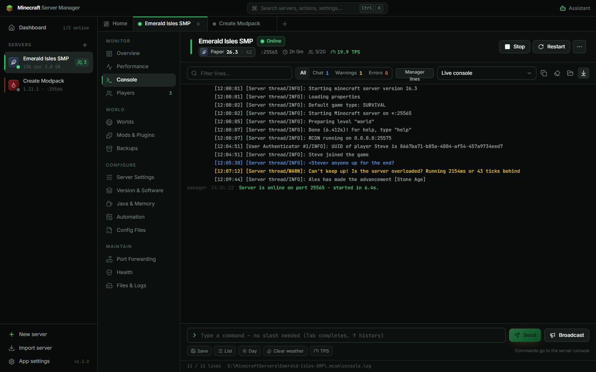 <br> **Console** – colours, filters, autocomplete |
| 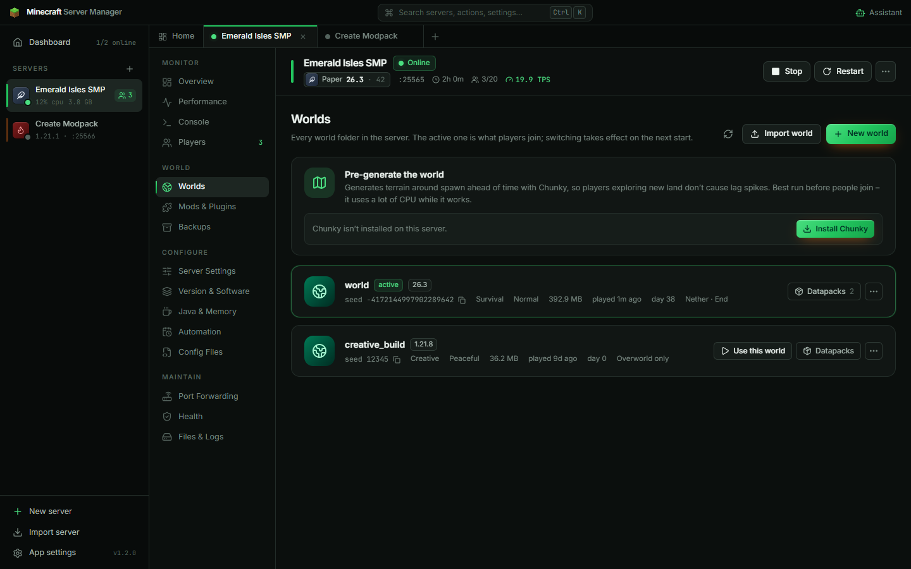 <br> **Worlds** – pre-generation, imports, datapacks | 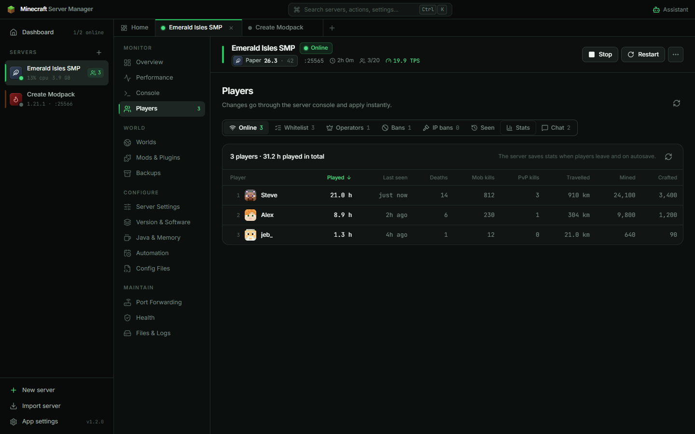 <br> **Player stats** – play time and more |
| 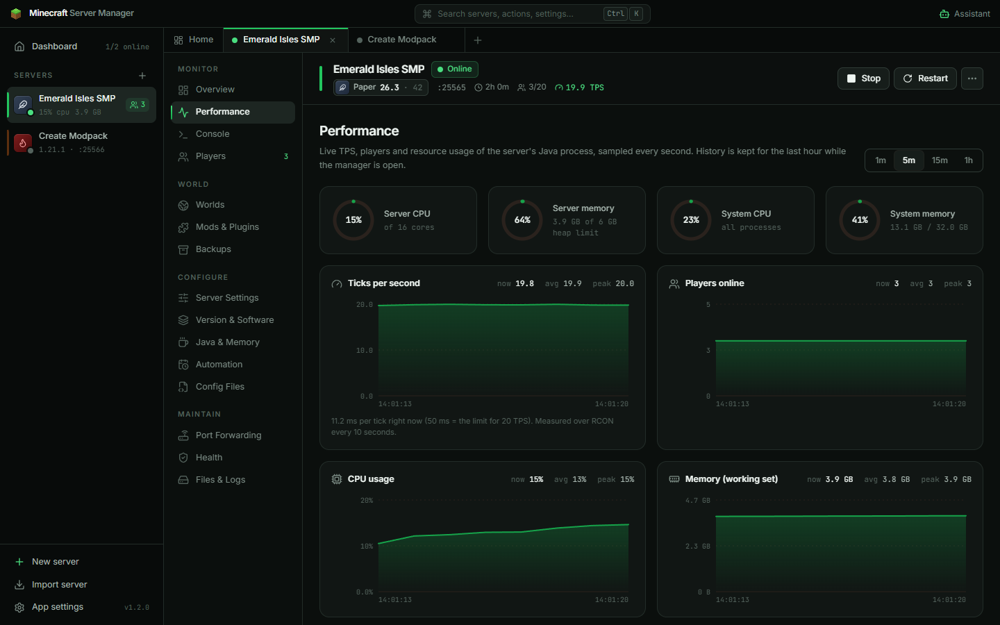 <br> **Performance** – TPS, MSPT, CPU and memory | 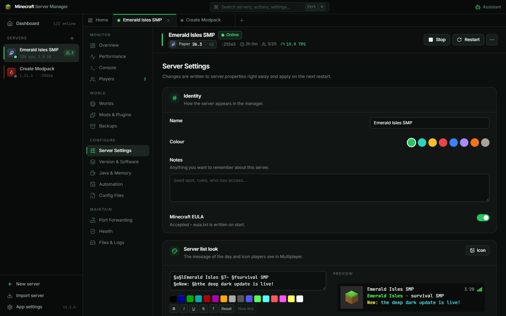 <br> **Server settings** – MOTD designer and every property |
| 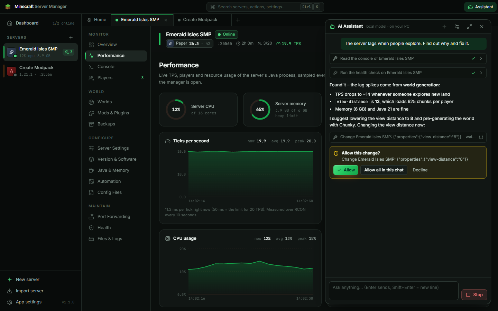 <br> **AI assistant** – local model, asks before changing anything | 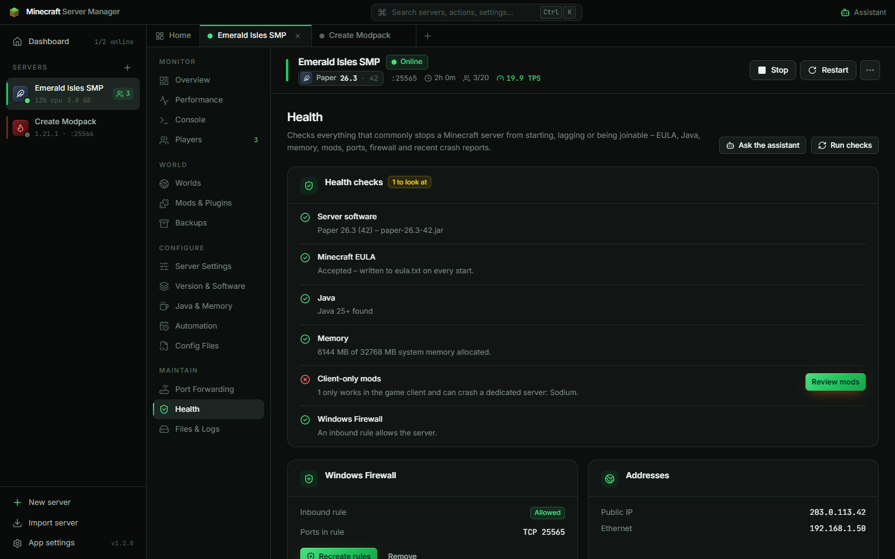 <br> **Health** – checks with a fix for each |

## 🧭 Supported server software

| Software | What it's for | Versions | Content |
|---|---|---|---|
| **Vanilla** | Mojang's own server | every release & snapshot with a server (1.2.5 → today) | datapacks |
| **Paper** | fast, the best default for plugins | all Paper builds | plugins (Modrinth, Hangar, CurseForge) |
| **Purpur** | Paper + hundreds of gameplay options | all Purpur builds | plugins |
| **Folia** | multithreaded, for very large player counts | all Folia builds | Folia-aware plugins |
| **Fabric** | lightweight mods, first on new versions | every Fabric-supported version | mods (Modrinth, CurseForge) |
| **Quilt** | Fabric-compatible mod loader | every Quilt-supported version | mods (incl. most Fabric mods) |
| **Forge** | the classic loader for big modpacks | every Forge build | mods |
| **NeoForge** | the modern Forge successor | every NeoForge build | mods |
| **Modrinth modpacks** | a complete pack (Cobblemon, Create…) as a server | whatever the pack targets | the pack's mods + configs |

## 🚀 Quick start

1. **Download** `Minecraft-Server-Manager-Setup.exe` from the [latest release](https://github.com/clawdroppin/Minecraft_Vanilla-Modded_ServerManager/releases/latest) and run it.
   *Windows SmartScreen may warn because the app isn't code-signed yet: **More info → Run anyway**.*
2. Click **New server** → pick **Vanilla / Paper / Fabric / Forge / NeoForge…** (or **Start from a modpack**) → pick the version.
3. Name it, choose memory, game mode and difficulty → **accept the Minecraft EULA** → **Create & install**.
4. Press **Start**. Share the address from the **Overview**.
5. For friends outside your home network open **Port Forwarding** → *Forward ports automatically* and *Allow through firewall*, then *Test from the internet*.
6. Want Bedrock friends too? **Mods & Plugins → Essentials → Bedrock crossplay → Set up**.
7. Want help? Install [Ollama](https://ollama.com) (`ollama pull qwen3:8b`), press **Ctrl+J** and ask the assistant anything.

The full walkthrough – every screen explained – is in the **[User guide](docs/USER_GUIDE.md)**.

### Downloads

| File | What it is |
|---|---|
| `Minecraft-Server-Manager-Setup.exe` | Installer (recommended) – data in `%APPDATA%\com.minecraftservermanager.app` |
| `Minecraft-Server-Manager.msi` | The same as an MSI package |
| `Minecraft-Server-Manager-Portable.zip` | No install – unzip anywhere writable; all data stays next to the exe |
| `SHA256SUMS.txt` | Checksums to verify the downloads |

## 🛠 Troubleshooting

| Problem | Fix |
|---|---|
| Friends can't join from outside | Port Forwarding → *Test from the internet*. Forward the port, allow the firewall, and check for **CGNAT** (then ask your ISP for a public IPv4 or use a tunnel such as playit.gg). |
| Server crashes right after start | Open **Health** – it flags client-only mods, wrong-loader mods, wrong Java and known fatal log lines, each with a fix. |
| Bedrock players can't connect | They use port **19132** (not 25565); forward **UDP 19132** and restart after setting up crossplay. |
| Lag when people explore | **Worlds → Pre-generate**, add Lithium/FerriteCore/ModernFix from Essentials, lower view distance. |
| The AI assistant can't connect | Start Ollama (or LM Studio's local server), open the assistant's ⚙ settings, pick the preset and press *Test*. Use a tool-capable model (Qwen 3, Llama 3.1+, gpt-oss, Gemma). |

More answers in the [user guide's troubleshooting section](docs/USER_GUIDE.md#12-troubleshooting).

## 🔒 Good to know

- **Your data stays yours.** No accounts, no telemetry. The app only talks to Mojang, the official loader sites, Modrinth/Hangar/CurseForge (when you browse), Eclipse Adoptium (Java), GeyserMC (crossplay) and mcsrvstat.us (only when you press *Test from the internet*). The AI assistant only talks to the AI server address you enter (your own PC by default).
- **The EULA is your decision** – servers start only after you accept the [Minecraft EULA](https://aka.ms/MinecraftEULA) in the app.
- **Your router and firewall only change when you click** the buttons for it.

## 🧑‍💻 For developers & AI agents

Built with **Tauri 2** (Rust backend) and **React 19 + TypeScript + Tailwind CSS 4**.

```bash
npm install
npm run tauri dev        # full app with hot reload
npm run dev              # UI only, in a browser, with a mock backend
npm run build:all        # installer + MSI + portable zip
```

- **[AGENTS.md](AGENTS.md)** – architecture, repository map, facts verified against real servers, invariants and the release process. Start here (AI assistants: `CLAUDE.md` points to it).
- **[docs/USER_GUIDE.md](docs/USER_GUIDE.md)** – what every screen does, for users.
- **[CHANGELOG.md](CHANGELOG.md)** – release notes.

Releases are built by GitHub Actions: pushing a `vX.Y.Z` tag publishes the installer, MSI, portable zip and checksums.

## 📄 License

[MIT](LICENSE) © clawdroppin. Minecraft is a trademark of Mojang Studios / Microsoft; this project is not affiliated with or endorsed by them.
